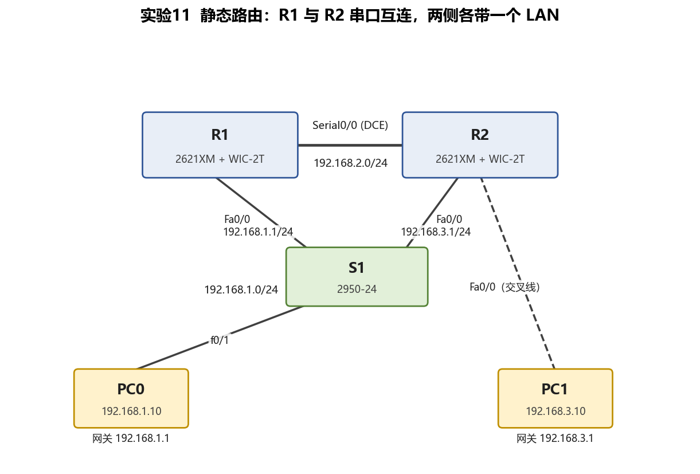
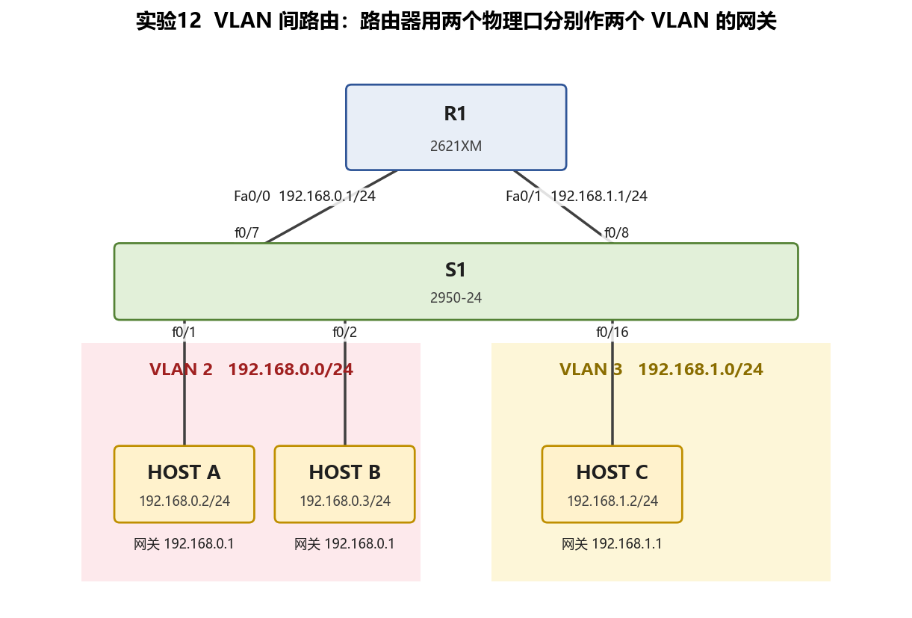
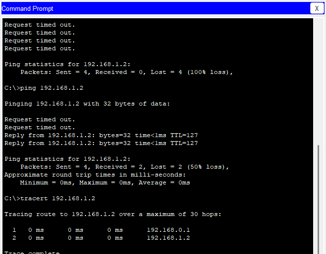

# cisco-pt-lab

在 **Cisco Packet Tracer**（Windows 桌面版）里搭建并验证网络实验的可复用技能：
放设备、连线、装模块、写配置、抓连通性证据、保存 `.pkt`。

它是 DeepSeek Harness（DSH）的 skill，也可以只当一份「PT 操作避坑手册」来读。

## 为什么有这个东西

这些步骤单独看都不难，但在 PT 里会撞上一堆非直觉行为：器件栏会横滚所以图标位置漂移、
双击设备偶尔打不开（对话框藏在主窗口后面）、连线工具是一次性的、装模块必须先关机、
CLI 里 Ctrl+V 经常无效、粘贴缺个换行就把下一条命令粘成 `endenable`、
PC 的控制台只吃第一条命令……这份技能把这些坑连同**处置方法**固化成流程，避免每次都重新踩。

## 效果

两个示例实验的拓扑（对应 `examples/` 里的命令）：





实测证据 —— 跨 VLAN ping/tracert（TTL=127 说明经 1 跳路由器）：



## 安装

DSH 会从这些位置加载 skill（`SKILL.md` 需要 `name` + `description` frontmatter）：

| 作用域 | 路径 |
|---|---|
| 用户级 | `<dshHome>/skills/cisco-pt-lab/`（Windows 通常是 `C:\Users\<你>\.dsh\skills\`） |
| 项目级 | `<项目根>/.dsh/skills/cisco-pt-lab/` |

把本目录整个复制过去即可，无需构建。

## 内容

```
SKILL.md                        技能正文：10 条铁律 + 七步流程 + 状态机 + 已知死路
examples/lab11-static-route.md  静态路由实验的完整命令（含四种路由写法）
examples/lab12-vlan-routing.md  VLAN 间路由实验（每 VLAN 一个物理口）+ 排错顺序
scripts/grid_shot.py            截屏 + 叠加坐标网格，用来读器件栏/端口菜单位置
```

## 核心方法论：坐标不写死

PT 的控件位置随窗口大小、缩放、面板滚动而变，记死像素必然失效。技能里的做法是：

1. 先用 `scripts/grid_shot.py` 抓一块**带坐标网格**的局部截图（放大 2 倍便于读数）；
2. 按网格读数点击；
3. 点完立刻用**状态栏文字 / 设备标签 / 端口名 / 对话框标题**复核；
4. 不符合预期就用 `Esc`、`Ctrl+Z` 或 `Window` 菜单纠正，而不是连点几个位置去猜。

```bash
python scripts/grid_shot.py --box 0 880 1200 1040 --scale 2 --out grid.png
```

## 几条最值钱的经验

- 选设备型号**只用器件栏搜索框**（输入 `2950-24` / `2621XM` / `PC-PT`），不要盲点图标。
- 双击打不开：先 `Esc` ×2 取消粘连的连线工具，再从 **Window 菜单**里把设备窗口调出来。
- 装 WIC-2T 串口模块：**先关机**再拖模块，否则报 “Cannot add a module when the power is on”。
- 路由器/交换机配置一律用窗口右下角的 **Paste 按钮**，文本以 `enable` 开头、以换行结尾。
- 粘错了出现 `Translating ...` 就按 **Ctrl+Shift+6** 中止 DNS 解析。
- 连完线用 `show cdp neighbors` 反查端口的对应关系——两根平行线在画布上会重叠。
- `ping` 第一次丢 1~2 个包是 ARP + STP 的正常现象，第二次应为 `0% loss`，否则才是真故障。

## 已知死路（别浪费时间）

- **离线生成 `.pkt`**：不可能，文件是加密二进制，只有 PT 自己 `Save As` 能写。
- **PT Scripting 自动建拓扑**：`Extensions → Scripting` 能跑脚本，但实测 `lw.addDevice()` 不创建设备。
- **Ctrl+V 往终端粘命令**：不可靠，用 `Paste` 按钮。

## 兼容性

- 正文以 **Packet Tracer 8.2.2** 在 Windows 11、125% 缩放下验证；PT 7.0 在高 DPI 下器件栏会错位。
- 设备操作部分按 DSH 的 Windows 桌面工具（`mcp__windows__*`）描述；换别的桌面自动化工具时，
  PT 本身的这些行为特征不变，只要替换“截图 / 点击 / 输入 / 快捷键”的调用方式即可。

## 说明

内容来自一次课程实验（静态路由 + VLAN 间路由）的实际操作与踩坑记录，仅用于学习与实验环境排障。
